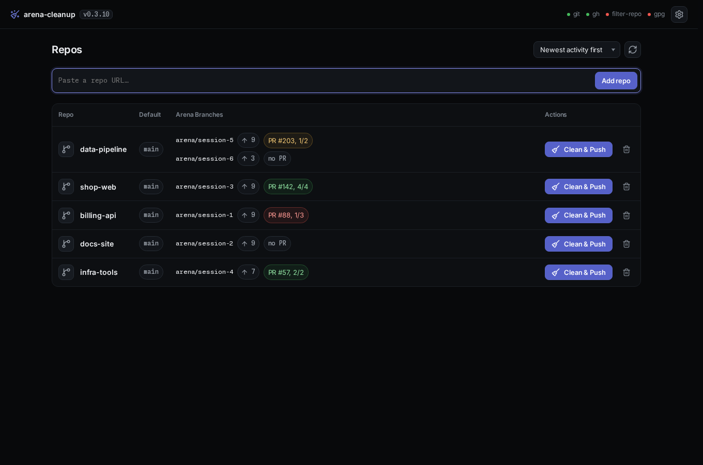

# arena-cleanup

A small web app that cleans an Arena agent branch. It rewrites the history to
your identity, signs the commits, and publishes the result to your default
branch. Paste a repo URL once. The dashboard then shows each repo's arena
branch, its distance from origin, and its pull request checks.



One click runs the pipeline:

1. Fetch and prune, select the arena branch, and reconcile it with upstream.
2. Wait for the pull request checks. Failing ones stop the run.
3. Remove the named paths from every commit, when asked.
4. Rewrite the commits to your identity, sign them, and move the tags.
5. `git push --force-with-lease` to the default branch, then delete the local
   arena branch.

Nothing leaves the machine except the git and `gh` calls you would have made by
hand.

## Install

### Docker Compose

The image carries `git`, `gh`, `git-filter-repo`, and `gnupg`. The host needs
none of them. A green CI run on `main` publishes
`ghcr.io/nemoe7/arena-cleanup:latest` for amd64 and arm64, the only tag. The
package is private: `docker login ghcr.io` with a token that has
`read:packages`, or `docker build -t arena-cleanup .` from a clone.

```console
cp .env.example .env
$EDITOR .env                                       # name, email, TS_AUTHKEY, TZ
docker compose up -d
docker compose exec arena-cleanup gh auth login    # once, if there is no token
```

Compose runs two containers: `arena-cleanup` on `127.0.0.1:8080` and
`arena-cleanup-tailscale`, which serves it to your tailnet as
`https://arena-cleanup.<tailnet>.ts.net`. That HTTPS name is what makes the
app installable on a phone. A PWA needs a secure origin, and plain `http://`
over the LAN is not one. `docker/tailscale-serve.json` holds the proxy config,
`tailscale serve` only, never `funnel`.

Compose reads `.env` from the checkout on its own, so nothing needs exporting
in your shell. `docker compose config` prints the result without starting
anything. The app is UI-only: paste a repo URL in the dashboard, and the server
clones it into the `arena-home` volume.

Neither container declares an ACL tag. Both run as the tailnet's default owner
identity and inherit its policy. Tags belong in the Tailscale admin console, not
in the compose file.

Without compose:

```console
docker run --rm -p 127.0.0.1:8080:8080 -v arena-home:/home/arena \
  -e GIT_AUTHOR_NAME="You" -e GIT_AUTHOR_EMAIL="you@example.com" \
  ghcr.io/nemoe7/arena-cleanup:latest
```

The `arena-home` volume keeps the `gh` token, the git identity, the GPG key,
the repo registry, and the clones. A rebuilt container keeps all of them.

`docker compose logs -f` shows one stamped line per job, repo change, and
failed request, in the zone of `TZ`. `command: ["-v"]` on the service adds
every request and every engine line.

### Python

Python 3.11+, `git`, and an authenticated `gh`. `git-filter-repo` is needed
only for path removal.

```console
python3 ui/server.py
```

| flag     | default                                         | meaning                            |
|----------|-------------------------------------------------|------------------------------------|
| `--data` | `$ARENA_DATA` or `~/.local/share/arena-cleanup` | registry, clones, runs, pictures   |
| `--host` | `0.0.0.0`                                       | interface to bind                  |
| `--port` | `8080`                                          | port                               |
| `-v`     | off                                             | log every HTTP request             |

### The CLI alone

`arena-cleanup.py` is the whole tool in one standard-library file. Copy it and
`arena-cleanup.cmd` somewhere on `PATH`, then run `arena-cleanup` inside a
clone. It needs Python 3.11+, `git`, and a signed-in `gh`, plus
`git-filter-repo` for `--path` and `gpg` for signing. `arena-cleanup -h` lists the
flags, and `arena-cleanup doctor` checks the setup.

## Use

1. Paste a clone URL, a GitHub page address, or a local path into the add box
   and press **Add repo**.
2. The gear icon opens **Settings**, one page for every per-machine setting:
   - **Identity**: the `git config` name and e-mail every claimed commit gets.
   - **GitHub**: `gh` sign-in (`GH_TOKEN`, `gh auth login`, or a pasted
     token), its scopes, and **Configure git credentials** for HTTPS clones. The
     token needs `repo`. SSH URLs need a mounted key instead.
   - **Signing**: the active GPG key, whether GitHub has it, and **Create
     key** when there is none. Add the public key under GPG keys in the GitHub
     settings with a verified e-mail, then **Re-check**.
   - **Claimed commits**: the e-mails and names whose commits a run rewrites
     onto the identity. Empty lists fall back to the built-in rules.
3. About sits below the settings.
4. **Clean & Push** runs the pipeline and streams the log. A click on the
   card shows the repo view first: target branch, paths to remove, the
   check timeout, and the options (dry run, skip the PR gate, leave tags
   alone, keep the branch, force the push).

Signed out, every card reads **checks unavailable** instead of **no PR**. The
run writes a backup bundle before each rewrite stage, and **Cancel** stops a
run in flight. Exit codes: `0` success, `1` error or cancelled, `2` usage, `7`
a check found commits to rewrite, `130` interrupted.

Path removal is `git-filter-repo --invert-paths` over every ref. Commits left
empty go. Signatures do not survive it, so the publish pass re-signs the branch
it pushes.

Tags that pointed into rewritten commits move with them, force-pushed with a
lease. **Don't move tags** leaves them and warns.

`Ctrl`/`Cmd` + `Enter` starts the selected command. On a phone the same page
stacks into one column, and the primary actions stick to the bottom.

## Settings

| variable                   | used for                                                   |
|----------------------------|------------------------------------------------------------|
| `GIT_AUTHOR_NAME`          | seeded into git config at start, while it is empty         |
| `GIT_AUTHOR_EMAIL`         | seeded into git config at start, while it is empty         |
| `GH_TOKEN`                 | `gh` auth without an interactive login                     |
| `ARENA_DATA`               | registry, clones, runs, pictures; see `--data` above       |
| `ARENA_HOST`, `ARENA_PORT` | bind address (default `0.0.0.0:8080`)                      |
| `TS_AUTHKEY`               | joins the Tailscale sidecar once; a volume keeps the node  |

The Settings page writes the identity and the claim rules into the global git
config: `user.name`, `user.email`, `arena.claim-email`, and `arena.claim-name`.
The claim keys are multi-valued (`git config --global --add`). While a claim key
is unset, the matching constant at the top of `arena-cleanup.py` applies:
`CLAIM_EMAILS` or `CLAIM_NAMES`. `ARENA_PREFIX` and `SIGN_COMMITS` stay
constants.

`GET /healthz` returns the version, uptime, and repo count. The image's
health check polls it, and compose gates the sidecar on that check.

The app has no authentication of its own. Keep it on `127.0.0.1` and behind
the tailnet or an SSH tunnel. The server checks every option from the browser
against a whitelist before it becomes an argv. There is no shell.

## Development

[uv](https://docs.astral.sh/uv/) manages the tool chain.

```console
uv sync
uv run pytest                      # CLI, web app, and compose tests
uv run ruff format arena-cleanup.py ui/server.py scripts/*.py tests
uv run ruff check --fix arena-cleanup.py ui/server.py scripts/*.py tests
uv run shfmt -i 2 -w docker-entrypoint.sh
markdownlint-cli2
uv run python .agents/skills/nemoizer/scripts/nemoize.py README.md  # prose, any text files
```

The tests run against throwaway repos: a real bare `origin`, a stub `gh`, and
a throwaway GPG key. Path and signing tests skip when `git-filter-repo` or
`gpg` is missing.

`uv run scripts/demo.py --port 8080` serves the UI on a throwaway fixture. It
holds five URL-cloned repos with a short history each, an identity, and
a key. Its stub `gh` answers from files under the demo root's `gh/` directory.
`--no-serve`
builds it and prints the environment.

One default branch moved on after its session, and one repo keeps two
arena branches.

Browser checks need Playwright: `uv sync --group qa`, then `uv run playwright
install chromium`, or a Chromium of your own.

```console
uv run pytest tests/e2e                           # spacing audit, history depth, log clock
uv run scripts/walk.py --out /tmp/walk            # press every control, one screenshot per step
```

Four workflows run on GitHub. `ci.yml` runs the lint, format, Markdown, and
pytest steps plus the spacing audit. `pr-check.yml` holds pull requests to the
contract in `scripts/check_pr.py`. `container-scan.yml` prints a Trivy report,
and `docker.yml` publishes the image.

`docs/design.md` is the design record.
