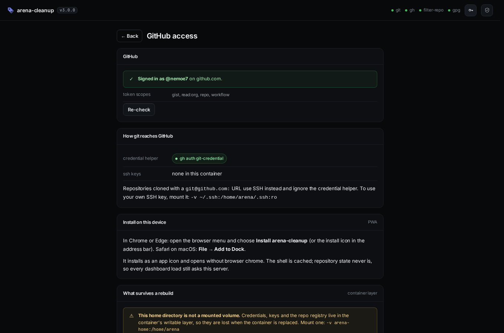
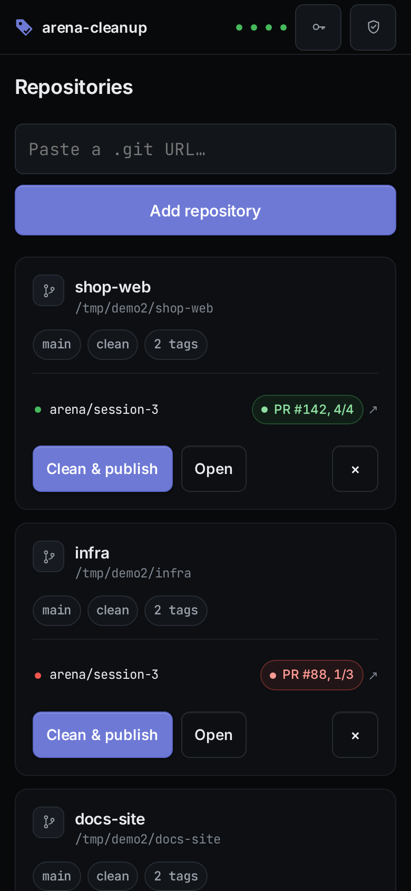
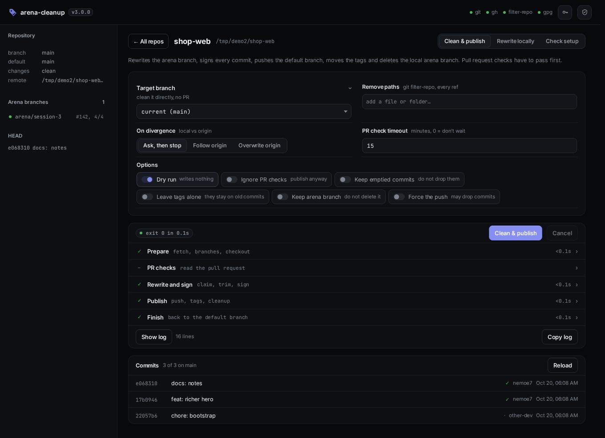
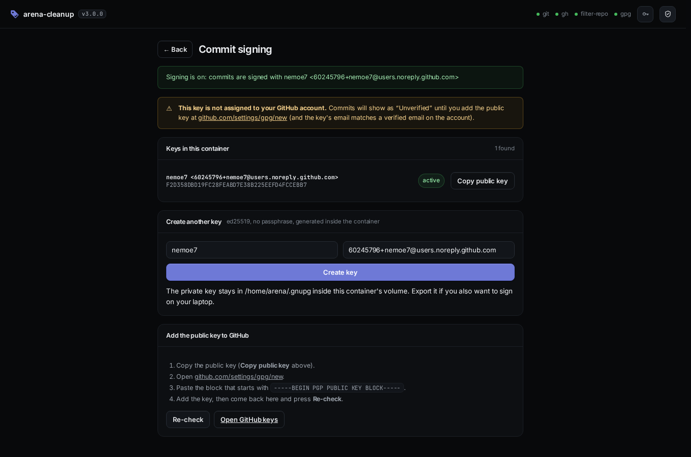

# arena-cleanup

A small web app that cleans an Arena agent branch, rewrites its history to your
identity, signs the commits, and publishes the result to your default branch.

Paste a repository URL once and it is remembered. The dashboard then shows, per
repo, how far its arena branch is ahead or behind, whether the tree is dirty, and
what its pull request checks say.


## Contents

- [What it does](#what-it-does)
- [Install](#install)
- [First run](#first-run)
- [Git and GitHub authentication](#git-and-github-authentication)
- [Use it as an app](#use-it-as-an-app)
- [The dashboard](#the-dashboard)
- [Cleaning a repository](#cleaning-a-repository)
- [Commit signing](#commit-signing)
- [Removing files and directories](#removing-files-and-directories)
- [Tags after a rewrite](#tags-after-a-rewrite)
- [What the run prints](#what-the-run-prints)
- [Reach it over Tailscale](#reach-it-over-tailscale)
- [What survives a rebuild](#what-survives-a-rebuild)
- [Health checks](#health-checks)
- [Settings and environment](#settings-and-environment)
- [Security](#security)
- [Development](#development)

## What it does

One click runs the whole pipeline:

1. `git fetch --prune origin`, then resolves the default branch from `origin/HEAD`.
2. Deletes stale local `arena/*` branches (no matching `origin/arena/*`).
3. Moves onto the arena branch to work on (asking when several exist).
4. Reconciles local with upstream: fast-forward when possible, stop when the two
   sides really diverged.
5. Stops early if the default branch already carries this work.
6. PR gate: finds the open PR, waits for running checks, aborts on failing ones.
7. Optionally removes files and directories from every commit (see
   [Removing files and directories](#removing-files-and-directories)).
8. Rewrites history: claims agent commits, sets your identity, trims messages to
   the subject line, signs them, and moves the tags that pointed into what it
   rewrote.
9. `git push --force-with-lease` onto the default branch, then updates origin's
   tags onto the rewritten commits.
10. Returns to the default branch and deletes the local arena branch.

Nothing leaves the machine except the git and `gh` calls you would have made by
hand. The app keeps one registry file and, for URL-added repos, one clone per
repository in its data directory.

## Install

### Docker (any machine, amd64 or arm64)

The image carries everything the app shells out to (`git`, `gh`,
`git-filter-repo` and `gnupg`), so the host needs none of them.

```console
git clone <this repo> && cd arena-cleanup

# build for this machine
docker build -t arena-cleanup .

# or build and push both architectures at once (needs buildx + a registry)
docker buildx build --platform linux/amd64,linux/arm64 \
  -t yourname/arena-cleanup:latest --push .
```

Run it:

```console
docker run --rm -p 8080:8080 \
  -v arena-home:/home/arena \
  -e GIT_AUTHOR_NAME="You" -e GIT_AUTHOR_EMAIL="you@example.com" \
  arena-cleanup
open http://localhost:8080
```

You do not need to mount a repository: paste its URL in the UI and it is cloned
into the container's data volume. If you would rather
work on a checkout that already exists on the host, mount it and add the path
instead:

```console
docker run --rm -p 8080:8080 \
  -v /path/to/repo:/repo \
  -v arena-home:/home/arena \
  -e GIT_AUTHOR_NAME="You" -e GIT_AUTHOR_EMAIL="you@example.com" \
  arena-cleanup
```

On a Raspberry Pi it is the same command: `docker build` produces an arm64 image
there, and the `buildx` line above publishes one tag that both a PC and a Pi can
pull.

That volume holds `gh`'s token, your git identity, the GPG key the UI creates,
the repo registry and any repos cloned from a URL, so a rebuilt container still
knows all of them.

Or with compose. This is the setup the rest of the README assumes: two
containers, a healthcheck on each, and the app published only through Tailscale.

```console
cp .env.example .env
$EDITOR .env                            # name, email, TS_AUTHKEY
docker compose up -d
docker compose exec arena-cleanup gh auth login    # once, if there is no token
```

`docker compose` reads `.env` from the directory it runs in, so those three
values need no `export`. The file is in `.gitignore`, and `.dockerignore` keeps
it out of the build context, so the auth key and token stay on the machine.
`docker compose config` prints the substituted file without starting anything,
which is the quickest way to check a mistyped variable name.

With plain `docker run` there is no `.env`: pass the same values with `-e`, as
the commands above do.

The containers are named exactly `arena-cleanup` and `arena-cleanup-tailscale`,
so `docker logs arena-cleanup` and `docker exec -it arena-cleanup gh auth status`
do what they look like. Compose publishes the app on `127.0.0.1:8080` only; the
tailnet is the way in.

Docker builds the image on first `up`, so a fresh clone takes a minute.

### Python (no Docker)

Python 3.11+, `git`, and `gh` authenticated.

```console
pip install git-filter-repo          # only needed for path removal
python3 ui/server.py --repo /path/to/repo
```

Then open <http://localhost:8080>.

| flag     | default                                         | meaning                            |
|----------|-------------------------------------------------|------------------------------------|
| `--repo` | `$ARENA_REPO`                                   | register this work tree on startup |
| `--data` | `$ARENA_DATA` or `~/.local/share/arena-cleanup` | repo registry and URL clones       |
| `--host` | `0.0.0.0`                                       | interface to bind                  |
| `--port` | `8080`                                          | port                               |
| `-v`     | off                                             | log every HTTP request             |

## First run

1. Paste a clone URL into the add box (`git@github.com:you/repo.git`,
   `https://github.com/you/repo.git`, …) and press **Add repository**. Private
   repos use the credentials already in the container, so run `gh auth login`
   once (or set `GH_TOKEN`) and cloning works. A path to a work tree on this
   machine works too.
2. Open the Access panel with the key icon. Already signed in with `GH_TOKEN` or
   `gh auth login`? It says so and you can skip the token. If not, paste one.
   See [Git and GitHub authentication](#git-and-github-authentication).
3. The shield icon in the top right opens the signing panel: the key, whether
   GitHub has it, and a button to create one if there is none. See
   [Commit signing](#commit-signing).
4. **Clean & publish** starts the run immediately and streams its output into
   the console.

Repositories are remembered across restarts, container rebuilds (the volume) and
browser reloads (the registry lives on the server, not in localStorage).

## Git and GitHub authentication

There are two separate credentials involved, and they fail in different ways.
The Access panel (the key icon, top right) shows both:



### gh, the GitHub CLI

`gh` is what reads pull requests and their check rollups. Three ways in, in the
order the panel tries them:

| way                     | when                                   | what it does                                        |
|-------------------------|----------------------------------------|-----------------------------------------------------|
| `GH_TOKEN` env var      | you started the container with a token | used automatically, no state kept                   |
| `gh auth login`         | you have a shell in the container      | interactive browser or token flow                   |
| paste a token in Access | neither of the above                   | hands it to `gh auth login --with-token` over stdin |

The token needs the `repo` scope for private repositories and PR checks;
`read:org` covers organisation repos. A fine-grained token needs *Pull requests:
read* (and *Contents: read* to clone). The panel prints the scopes it can see and
says when `repo` is missing, because a token without it authenticates cleanly and
then silently sees no pull requests.

The token goes to `gh` through stdin, never on a command line. It lands in the
container's `arena-home` volume, so it survives a rebuild. It is never written
into the page, and the field is a password input that is cleared on success.

### git: cloning and pushing

Signing in to `gh` does **not** configure git. Until `gh auth setup-git` has run,
an HTTPS clone of a private repo fails with a password prompt that nobody is
there to answer. The panel detects that and offers **Set up git credentials**,
which is one command and applies to every repository in the container.

| URL shape                         | how git authenticates                          |
|-----------------------------------|------------------------------------------------|
| `https://github.com/you/repo.git` | the credential helper from `gh auth setup-git` |
| `git@github.com:you/repo.git`     | SSH - ignores the helper, needs a key          |

For SSH, either mount your own key (`-v ~/.ssh:/home/arena/.ssh:ro`) or generate
one in the container with `ssh-keygen` and add it to GitHub; the panel lists
which keys it can see.

### What happens when it is not connected

Signed out, every arena branch reads **checks unavailable** instead of
**no PR**. An empty result from `gh` and no `gh` at all
look identical, so "no PR" would be a claim the app cannot support. A banner
across the top of the dashboard offers **Connect GitHub**.

Signing in or out invalidates the cached repository status, so the cards correct
themselves immediately instead of eight seconds later.

## Use it as an app

The UI is a PWA. On a phone or a desktop browser you can install it and it opens
full screen with its own icon and no address bar.



**Android (Chrome, Edge, Samsung Internet):** open the site, then either tap
**Install app** in the Access panel or use the browser menu then *Install app*.
On Chrome the install icon appears in the address bar when the page qualifies.

**iOS / iPadOS (Safari):** tap **Share**, scroll down, **Add to Home Screen**.
Safari has no install prompt, so that is the only route. The Access panel says
so on an iPhone instead of showing a button that would do nothing.

**Desktop:** Chrome and Edge show an install icon in the address bar; Safari on
macOS has **File → Add to Dock**.

### The one requirement: a secure origin

Browsers only install apps, and only run service workers, from a **secure
context**: `localhost`, or HTTPS. Plain `http://192.168.1.20:8080` from your
phone is neither, and the failure is silent. The Access panel detects this and
says so instead of failing quietly. Three ways to get a secure origin:

1. Open `http://localhost:8080` on the same machine the container runs on.
2. Put it behind a TLS-terminating reverse proxy (Caddy, nginx, Traefik) and open
   the HTTPS name. The app reads `X-Forwarded-Proto`.
3. Reach it over Tailscale, which gives every device an HTTPS name for free.

### What is cached, and what never is

|                    |                                                                |
|--------------------|----------------------------------------------------------------|
| cached (app shell) | the page, fonts, icons, manifest - so the icon opens instantly |
| **never** cached   | every `/api/` response, the job event stream                   |

A cached status would go stale between runs, so a card could still claim checks
had passed long after they failed. When the server cannot be reached the app
says **Cannot reach the server** and renders no dashboard at all.

The worker is served with `Cache-Control: no-store`, so a rebuilt container is
picked up on the next load rather than being shadowed by an old shell.

## The dashboard

Every remembered repo is one card:

| on the card    | means                                                               |
|----------------|---------------------------------------------------------------------|
| `main`         | the default branch resolved from `origin/HEAD`                      |
| `clean`        | working tree has no uncommitted changes (otherwise `n uncommitted`) |
| `↑1 ↓2`        | commits ahead of / behind origin's default branch                   |
| `3 tags`       | tags in the repo                                                    |
| green dot      | an open PR for that arena branch, all checks passed                 |
| red dot        | an open PR with failing checks                                      |
| blue dot       | an open PR with checks still running                                |
| grey dot       | the branch exists, no open PR                                       |
| `PR #88 · 1/3` | the PR and its passed/total checks; the pill links out to it        |

**Clean & publish** opens the repo view and starts the full pipeline with the
defaults. **Open** shows the repo view without starting anything. The `×`
forgets the repo (and deletes the clone if the app made it).

Status is re-read on page load, after every run, and every 20 seconds while the
dashboard is open. It is cached for 8 seconds, so clicking around does not hammer
`gh`.

## Cleaning a repository



- **Target branch:** clean a branch directly, without a PR. Empty means "the
  current branch"; clicking an arena branch in the sidebar selects it.
- **Remove paths:** one chip per path (`uploads/`, `docs/old.md`). Enter adds,
  Backspace removes the last. This rewrites *every* ref, which the small print
  says.
- **On divergence:** a run started from the UI has no terminal to ask on, so
  *Stop & report* (the default) cancels instead of guessing; *Use remote* and
  *Keep local* answer in advance.
- **PR check timeout:** minutes to wait for running checks (`0` = do not wait).
- **Options:** dry run, skip the PR gate, keep empty commits, do not move tags,
  keep the local branch, force past the push guard. Options that only mean
  something to a publish are hidden while `Rewrite locally` is selected.

Three tasks sit top right, and the line under the header says what the selected
one will do:

| task              | what it does                                            |
|-------------------|---------------------------------------------------------|
| `Clean & publish` | fetch, PR gate, rewrite, sign, push, move tags, cleanup |
| `Rewrite locally` | rewrite and sign inside the container; never pushes     |
| `Check setup`     | reads git, gh, identity and signing; writes nothing     |

The button in the run card carries the task's name, and the exact argv is in its
tooltip, so the UI never does anything you could not have spelled out yourself.

A finished run reads as a list of phases: `Prepare`, `PR checks`, `Rewrite and
sign`, `Publish`, `Finish`. Each row shows its own result, its elapsed time, and
opens to the lines it produced. The raw log is folded behind **Show log** with a
line count, and **Copy log** takes it all. **Cancel** stops a run in flight.

The **Commits** card answers "what changed": how many commits are on the branch,
then one row per commit with the short SHA, subject, author, date, and a tick when
the commit is signed. Diffs are not rendered here; the PR link on the dashboard
opens GitHub when you want to read one.

A run is a child process. **Cancel** terminates it; the engine writes a backup
bundle before it moves any ref, so nothing is unrecoverable.

### On a phone

The same page, no separate build: cards stack into one column, the options card
becomes a single column, and the primary actions stick to the bottom of the
screen so a run is still two taps away.


### Keyboard

| key                          | does                         |
|------------------------------|------------------------------|
| `Ctrl`/`Cmd` + `Enter`       | start the selected command   |
| `Enter` (in the path box)    | add the typed path as a chip |
| `Backspace` (empty path box) | remove the last chip         |

## Commit signing

The engine signs every commit it rewrites. A signature is only worth anything if
GitHub has the matching public key, so the panel does both halves:



With no key in the container, type a name and email and press **Create key**.
The key is generated inside the container (ed25519, no passphrase, because a
background run cannot answer a prompt) and made the active `user.signingkey`.

**Copy public key** puts it on the clipboard for GitHub → Settings → SSH and GPG
keys → New GPG key. The email on the key must be a verified email on the account,
or GitHub shows the commit as unverified anyway.

**Re-check** asks `gh api user/gpg_keys` again. Until the key is on the account
the panel keeps a warning banner: *"This key is not assigned to your GitHub
account. Commits will show as Unverified."* That banner is the only nag in the
app, and it comes back on every visit while the key is missing.

When the container holds more than one secret key, each is listed with its
fingerprint, and **Use** makes one active.

The private key lives in `~/.gnupg` inside the container's volume. Export it if
you also want to sign commits on your laptop. If `gh` cannot be reached, the
panel says so instead of pretending the key is verified.

## Removing files and directories

In the UI, put the paths in **Remove paths** and run. Under the hood that is
`git-filter-repo --invert-paths`, so:

- Paths are matched from the repository root and can be files or directories;
  `uploads\2024` works on Windows.
- Every ref is rewritten, not just the branch being cleaned. Content left on
  another branch or tag is still clonable, so leaving those refs alone would not
  remove anything from history.
- A path that matches nothing is an error. filter-repo would silently do
  nothing, which looks exactly like success.
- A commit that only touched the removed paths becomes empty and is dropped, on
  the theory that its whole point is gone. **Keep empty commits** keeps it.
- Commit messages stay byte for byte (`--preserve-commit-hashes`,
  `--preserve-commit-encoding`); this stage is about files, not wording.
- The stage writes its own backup bundle (`git-pre-filter-repo-<stamp>.bundle`),
  then puts back the remote and remote-tracking refs that filter-repo removes.
- Commit signatures do not survive it: filter-repo rebuilds commit objects and
  cannot carry a signature into a new one, so every signed commit it rewrites, including ones on
  branches this run does not otherwise touch, comes out unsigned. `run` re-signs the branch it publishes; other refs need a hand.
- Commits that the removal prunes are excluded from the push guard, so a path
  run does not need **Force** to publish what it was asked to publish.
- One run publishes one branch. Other branches on origin keep their old commits
  and the removed files with them, so the run lists those branches in a warning.
  Clean each one with its own run.

## Tags after a rewrite

A rewrite gives every commit a new hash, so a tag that is not moved ends up
naming a commit the branch no longer contains, and `git checkout v1` would hand
back exactly the history that was just cleaned. Both stages keep tags attached:

- `git filter-repo` re-points tags whose commits it rewrote.
- The claim/sign pass re-points them again for the commits it rewrote itself,
  rebuilding annotated tags as new tag objects with the original tagger, date and
  message (git cannot edit a tag object in place).

What that means in practice:

- A changed annotated tag has a new object hash, and origin rejects the update
  without force, so a run force-pushes exactly the tags whose object changed,
  each with a lease pinned to the hash origin had.
- "Exactly the tags whose object changed" means: untouched tags are not pushed,
  tags that do not exist on origin are never created, no tag is ever deleted,
  and a tag whose commit is not part of what this run publishes stays where it
  is (and is named in a warning), because moving it would leave origin with a tag
  pointing into history none of its branches have.
- **Don't move tags** skips that and warns instead: the removed content stays
  reachable through the tags origin still has.
- A signed tag loses its signature when re-pointed (the signature covers the
  target), so re-sign it with `git tag -s -f <name> <commit>`.

Tags are moved twice when both stages run. There are two rewrites, and a tag has
to name a commit that exists at the end:

1. `filter-repo` rewrites every ref and re-points the tags itself. It cannot
   sign, and it drops signatures while rebuilding objects, so the signing pass
   has to come after it.
2. That signing pass rewrites the published branch again, giving those commits
   yet another hash, so tags into them are re-pointed a second time.

The second movement is conditional: when the signing pass finds nothing to do
the walk ends at "nothing to rewrite" and no tag is touched. Doing it in one
pass would mean giving up signing, because `git fast-import` has no way to
produce a signed commit.

## What the run prints

One line per event, ISO 8601 local time with offset, streamed to the page and
kept for replay:

```console
2026-10-08T04:10:32+08:00 INFO  switching to arena/session-b
2026-10-08T04:10:32+08:00 OK    check "ci": SUCCESS
2026-10-08T04:10:32+08:00 WARN  origin/main also has 1 commit(s) this branch does not have:
2026-10-08T04:10:32+08:00 ERROR working tree has 1 uncommitted change(s) and this run switches branches:
```

- levels are `INFO`, `OK`, `WARN`, `ERROR`; the page colours them and drops the
  timestamp to the left margin.
- git and `gh` output is muted; it is printed indented and untimestamped only
  when a command fails. The failing command's real output is what you see.
- a non-zero exit ends the run and marks the log red; nothing else is swallowed.

Exit codes:

| code | meaning                                           |
|------|---------------------------------------------------|
| 0    | success                                           |
| 1    | error, or a cancelled run                         |
| 2    | usage error                                       |
| 7    | a `strip` check found commits that need rewriting |
| 130  | interrupted                                       |

What changes in the repo, by mode:

| mode               | default branch           | arena branch               | working tree        |
|--------------------|--------------------------|----------------------------|---------------------|
| `Run`              | replaced, force-pushed   | local deleted, remote kept | returned to default |
| `Run` + keep local | replaced, force-pushed   | both kept                  | returned to default |
| `Run` + target     | cleaned in place, pushed | untouched                  | stays on target     |
| `Run` + paths      | as above, paths removed  | as above, paths removed    | as above            |
| `Strip`            | untouched                | rewritten locally          | unchanged           |
| `Doctor`           | untouched                | untouched                  | untouched           |
| any + dry run      | untouched                | untouched                  | untouched           |

Safety rails: a backup bundle is written before each rewrite stage
(`git-pre-filter-repo-<stamp>.bundle` and `git-pre-rewrite-<stamp>.bundle` in the
temp dir), refs move with compare-and-swap, and the push is lease-protected
against the value fetched at the start.

## Reach it over Tailscale

The compose file runs a sidecar: `tailscale/tailscale` joined to your tailnet, on
the same Docker network as the app. The app publishes on `127.0.0.1:8080` only,
so the tailnet is the way in.

```text
your phone  ->  https://arena-cleanup.<tailnet>.ts.net  ->  [tailscale]  ->  arena-app:8080
```

| what          | how                                                                            |
|---------------|--------------------------------------------------------------------------------|
| node name     | `arena-cleanup`, so the URL is `https://arena-cleanup.<tailnet>.ts.net`        |
| exposure      | `tailscale serve` - tailnet only. Not `funnel`, which is public                |
| TLS           | automatic, so the origin is secure and the app is installable                  |
| node identity | kept in the `tailscale-state` volume, so a rebuild rejoins as the same machine |
| ACL tags      | none. The node inherits whatever your user identity already has                |
| health        | `tailscale status --json`, which fails until the node is logged in and up      |

The sidecar reads `docker/tailscale-serve.json`:

```json
{
  "TCP": { "443": { "HTTPS": true } },
  "Web": {
    "${TS_CERT_DOMAIN}:443": {
      "Handlers": { "/": { "Proxy": "http://arena-app:8080" } }
    }
  }
}
```

`${TS_CERT_DOMAIN}` is filled in by the tailscale image with the node's own
MagicDNS name, so the file has no tailnet name in it.

The proxy dials `arena-app`, not `arena-cleanup`. The sidecar has to be
*hostnamed* `arena-cleanup` for the node to get that MagicDNS name, and a
container's own hostname resolves to itself inside it, so a proxy pointed at
`arena-cleanup:8080` would dial the sidecar's own port and fail with
`connect: connection refused`. Compose gives the app the `arena-app` alias on
the same network, which can only mean the app.

There is deliberately no `AllowFunnel` key: serve only. If you do want public
access later, that is a decision to make in the admin console, not a default
here.

Check it from the host:

```console
docker exec arena-cleanup-tailscale tailscale status
docker exec arena-cleanup-tailscale tailscale serve status
```

The first `up` needs `TS_AUTHKEY`. After that the state volume carries the node
key, and the auth key can be revoked in the admin console, since it is only
needed to join once.

If the browser shows an error and `docker logs arena-cleanup-tailscale` has
`proxy error: dial tcp ...: connect: connection refused`, the sidecar is up and
the app is not answering on 8080. Two things cause that, and one command tells
them apart:

```console
curl -s localhost:8080/healthz     # the app, straight from the host
```

An answer here means the app is fine and the sidecar is dialling the wrong
thing, which is the hostname collision above; recreate both containers after
pulling the current compose file with
`docker compose up -d --force-recreate`. No answer means the app is down:
`docker compose ps` shows whether it is restarting, and `docker logs
arena-cleanup` says why. The usual reason is `/home/arena` on a bind mount
owned by another user, which stops the entrypoint before the server starts.

## What survives a rebuild

Credentials do not live in the image. They live in `$HOME`, which compose mounts
as the `arena-home` volume:

| what                  | where                              | survives rebuild |
|-----------------------|------------------------------------|------------------|
| GitHub token          | `/home/arena/.config/gh/hosts.yml` | yes - volume     |
| git identity + helper | `/home/arena/.gitconfig`           | yes - volume     |
| GPG signing key       | `/home/arena/.gnupg`               | yes - volume     |
| repo registry         | `<data>/repos.json`                | yes - volume     |
| clones from a URL     | `<data>/repos/`                    | yes - volume     |
| `git` `gh` `gpg`      | image                              | reinstalled      |
| `git-filter-repo`     | image                              | reinstalled      |

So `docker compose up -d --build` after a `docker compose down` needs no
re-authentication: the token is still in the volume, `gh auth status` still
answers, and the dashboard still lists your repos. `git-filter-repo` is the
opposite case. It is a tool rather than state, so the image reinstalls it and
nobody sets it up.

The Access panel shows this table for the container you are actually running,
read from `/proc/self/mountinfo`. If `$HOME` is not under a mount, every
credential row is marked **lost on rebuild** and the card tells you the exact
`-v` to add. A file in the container's writable layer is here now and gone after
the next `docker rm`.

## Health checks

Both containers answer a healthcheck, and compose gates the sidecar on the app
being healthy.

| container                 | check                     | means                      |
|---------------------------|---------------------------|----------------------------|
| `arena-cleanup`           | `GET /healthz` -> 200     | the server answers HTTP    |
| `arena-cleanup-tailscale` | `tailscale status --json` | joined, logged in, running |

`/healthz` is deliberately cheap: no `git`, no `gh`, no subprocess. It returns
the version, uptime and how many repos are registered.

```console
$ curl -s localhost:8080/healthz
{"ok": true, "version": "0.1.0", "uptime": 1842.6, "repos": 3}
```

`/api/health` is the same payload. `docker compose ps` shows both as `healthy`;
`depends_on: condition: service_healthy` means the sidecar does not start
advertising a backend that is not up yet.

## Settings and environment

Per-machine settings are constants at the top of `engine.py`, because they are
not per-run choices:

| constant       | default                                              |
|----------------|------------------------------------------------------|
| `AUTHOR_NAME`  | `nemoe7`                                             |
| `AUTHOR_EMAIL` | `60245796+nemoe7@users.noreply.github.com`           |
| `BLACKLIST`    | `arena-ai-coding-agent[bot]`, `arena-agent`, `arena` |
| `ARENA_PREFIX` | `arena/`                                             |
| `SIGN_COMMITS` | on                                                   |

Environment:

| variable                   | used for                                                   |
|----------------------------|------------------------------------------------------------|
| `GIT_AUTHOR_NAME`          | seeded into git config at container start                  |
| `GIT_AUTHOR_EMAIL`         | seeded into git config at container start                  |
| `GH_TOKEN`                 | `gh` auth without an interactive login (simplest connect)  |
| `ARENA_DATA`               | registry + clones (default `~/.local/share/arena-cleanup`) |
| `ARENA_REPO`               | repo registered on startup (default `/repo`)               |
| `ARENA_HOST`, `ARENA_PORT` | bind address (default `0.0.0.0:8080`)                      |

`GIT_AUTHOR_NAME`/`GIT_AUTHOR_EMAIL` are only a seed: once the container has a
volume, `git config --global` inside it wins, including changes the signing
panel makes. Under compose all of the variables in the table come from `.env`
when it exists; the shell environment is only consulted for names that the file
does not set.

## Security

- **The app has no authentication of its own.** Anyone who can reach the port
  can rewrite any registered repo. Compose therefore publishes it on
  `127.0.0.1:8080` only and puts the tailnet in front, where Tailscale's ACLs
  decide who gets in. A bare `docker run -p 8080:8080` puts it on the LAN for
  everyone; prefer `-p 127.0.0.1:8080:8080` and an SSH tunnel if you are not
  using Tailscale.
- Everything the browser sends is validated against a whitelist before it
  becomes an argv. There is no shell: each option is its own argument, and
  anything starting with `-` (branches, paths) is rejected.
- Static files are served from one directory with a path-traversal check.
- The GPG private key never leaves the container. Only the public key is
  displayed, and only when you ask for it.
- A GitHub token posted to `/api/auth` is passed to `gh` over stdin and stored in
  the container's volume. It is never echoed back: `/api/auth` reports the login
  name and scopes, never the token.
- The Tailscale sidecar declares no ACL tag, so it is bound by the same policy
  as your user identity rather than by a broader tag policy written for
  containers.

## Development

```console
bash run-tests.sh
```

462 checks against throwaway repos in a temp dir: a real bare `origin`, a stub
`gh` that plays no-PR/green/failing/running/superseded rollups, a throwaway GPG
key, and pty-driven runs that type answers into the prompts. It covers the
rewrite rules, idempotency, the PR gate, the push lease, multiple arena
branches, divergence choices, uncommitted-change handling, dry-run read-only
guarantees, path removal, tag movement (annotated and lightweight), and the web
app's repo store, clone-from-URL path, job argv, event stream, signing endpoints,
gh sign-in and sign-out (including the "checks unavailable" state), the PWA
manifest, icons and service worker, `/healthz`, the storage report, job
cancellation being distinguishable from a crash, and input validation.

The path and app sections skip cleanly when `git-filter-repo` is missing; the
summary says `SKIPPED: n section(s)` so a green run cannot hide it.

### The two QA tools

Both are local-only: they drive a real Chromium against a URL you give them and
write their results to disk. Neither talks to a service.

**`tools/measure.py`** walks the four views and dumps the computed padding,
margin and gap of every element, then reports what is off the stylesheet's
scale:

```console
python3 tools/measure.py --url http://localhost:8080 --out /tmp/measure
# compare against a saved run, and fail the shell when spacing drifts
python3 tools/measure.py --url http://localhost:8080 --out /tmp/after \
  --against /tmp/measure/report.json --fail-on-offgrid
```

It prints a histogram, every off-scale value with the selector that owns it,
"loners" (a value used once in a component whose siblings agree), and it saves a
full-page screenshot per view so the numbers can be checked against pixels. The
stylesheet uses one 2px scale, `1 2 4 6 8 10 12 16 20 24 32 40`, and a comment
at the top of the `<style>` block says so.

**`tools/walk.py`** presses every control in the app and asserts what each one
did. It clicks cards, the command switch, every toggle, the path chips, cancel,
copy, every back button and the token form, and it goes through the states that
are easy to forget: empty, offline, signed out, a rejected token, a cancelled
run.

```console
python3 tools/walk.py --url http://localhost:8080 --out /tmp/walk
# the same walk driven through the Playwright CLI instead of the library
python3 tools/walk.py --driver cli --url http://localhost:8080 --out /tmp/walk-cli
```

The walk flips signed-in state through `--gh-flag <file>`: it writes or removes
that marker and then re-checks `/api/auth`, which is what the demo fixture's `gh`
stub reads. The same fixture also supplies the signing key and the git identity,
so start that server with `GNUPGHOME` and `GIT_CONFIG_GLOBAL` pointing at it;
otherwise the app sees the host's `gh` and no key, and about a dozen steps fail
for reasons that have nothing to do with the UI.

Both drivers share one `walk_view()`, so the two runs assert the same things and
disagree only when the driver does. The `cli` driver shells out to
`playwright cli` and adapts its snapshot-and-locator interface to the same small
page object (`CliPage`), including a keyboard shim, because the CLI has no
`keyboard` object of its own.

58 steps at desktop and phone widths, one screenshot per step
(`docs/walk/` holds the last run), a `walk-report.json`, and a non-zero exit if
any step fails or the console logs an error. The cancel step parks a real run at
the PR gate (the stub `gh` reports a check that never finishes), presses
**Cancel** there, and waits for `cancelled`, so the button meets a live process
rather than a job that already exited.

It found four bugs while being written: no Start button on desktop, `back` from
Access landing in a repo you had already left, a cancelled run reported as
`exit -15`, and a `gh pr view` response shaped like a list reaching the engine
as an AttributeError instead of a message.

Formatting contracts:

- `.editorconfig`: `indent_size = 2` for everything
- `pyproject.toml`: Ruff, `indent-width = 2`, `ignore = ["BLE001", "S110"]`
- `.markdownlint.json`: `{"default": true, "MD013": false, "MD060": true}`

```console
ruff format --config pyproject.toml engine.py ui/server.py tools/*.py
ruff check --config pyproject.toml --fix engine.py ui/server.py tools/*.py
shfmt -i 2 -w run-tests.sh docker-entrypoint.sh
markdownlint README.md
```

### Layout

| path                          | what it is                                               |
|-------------------------------|----------------------------------------------------------|
| `ui/server.py`                | HTTP server, repo registry, jobs, signing, JSON API      |
| `ui/static/index.html`        | the whole front end: no build step, no CDN, no framework |
| `ui/static/fonts/`            | Inter and JetBrains Mono, self-hosted (OFL)              |
| `engine.py`                   | the rewrite engine; spawned per run, one process each    |
| `run-tests.sh`                | the 462-check suite                                      |
| `tools/measure.py`            | spacing auditor: computed styles vs the 2px scale        |
| `tools/walk.py`               | presses every control, screenshots each step             |
| `docker-compose.yml`          | `arena-cleanup` + `arena-cleanup-tailscale`              |
| `docker/tailscale-serve.json` | the `tailscale serve` config the sidecar mounts          |
| `.env.example`                | the settings `docker compose` reads from `.env`          |
| `Dockerfile`                  | Debian slim + git, gh, git-filter-repo, gnupg            |
| `pyproject.toml`              | the version, under `[project]`, and the Ruff settings    |

The front end is a single page with four views (dashboard, repo, signing,
access). It reaches the server through one `fetch` wrapper and follows a run over
one `EventSource`. The registry is a JSON file in the data directory; clones
added by URL live next to it under `repos/`.
