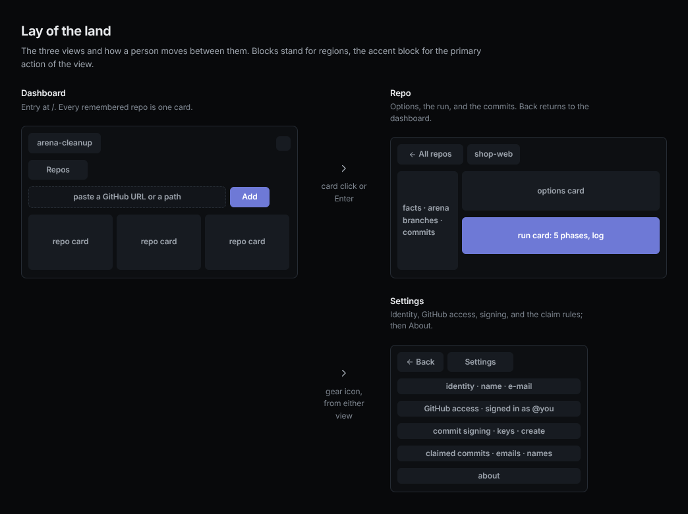
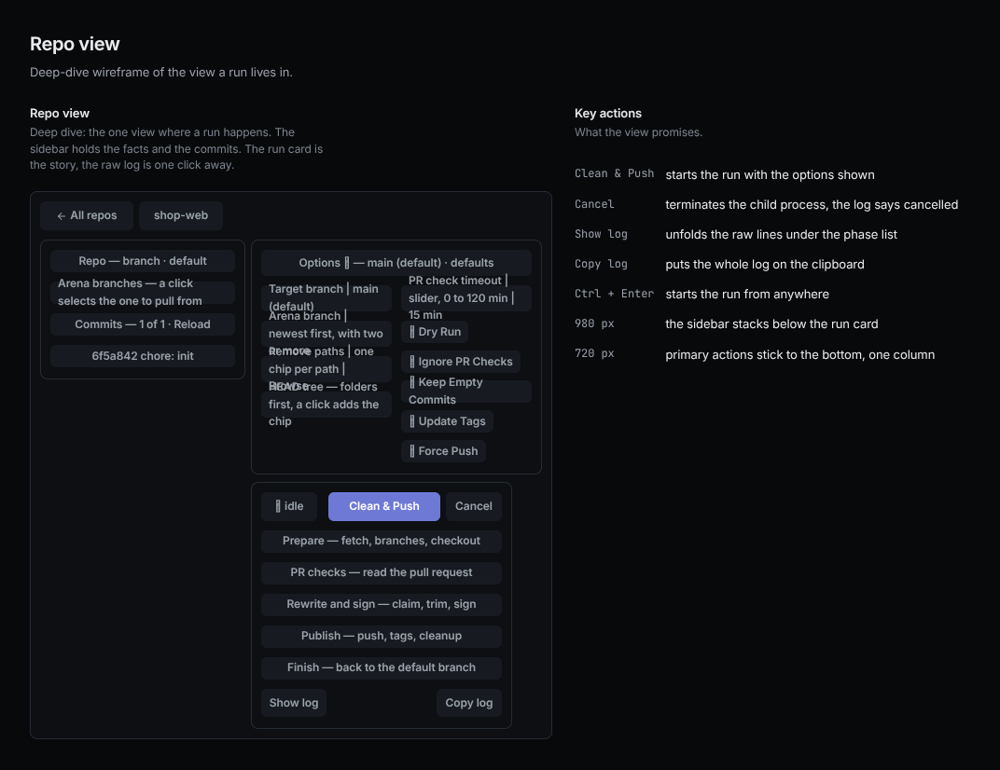
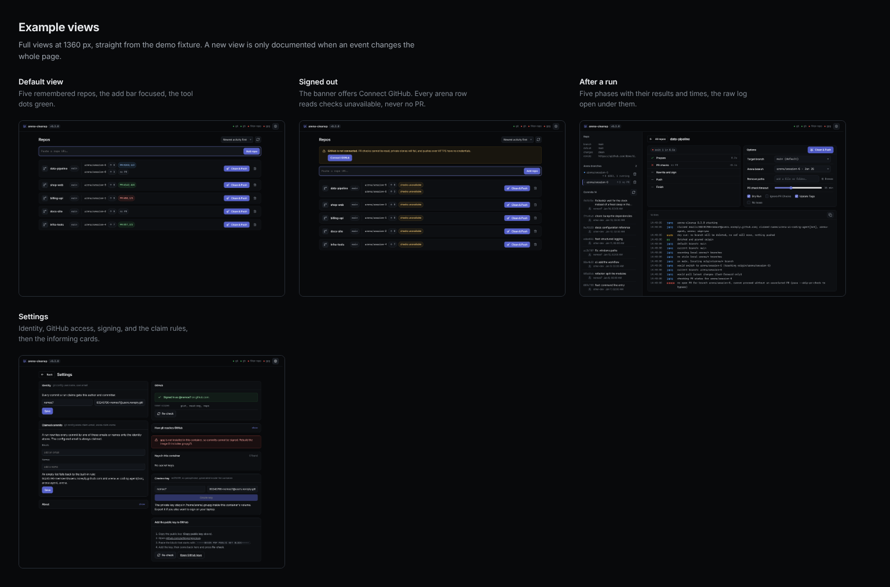
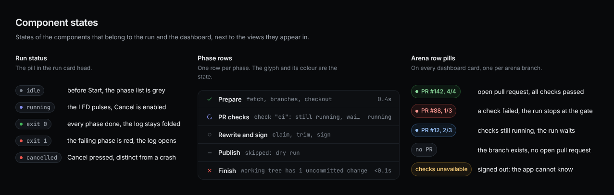
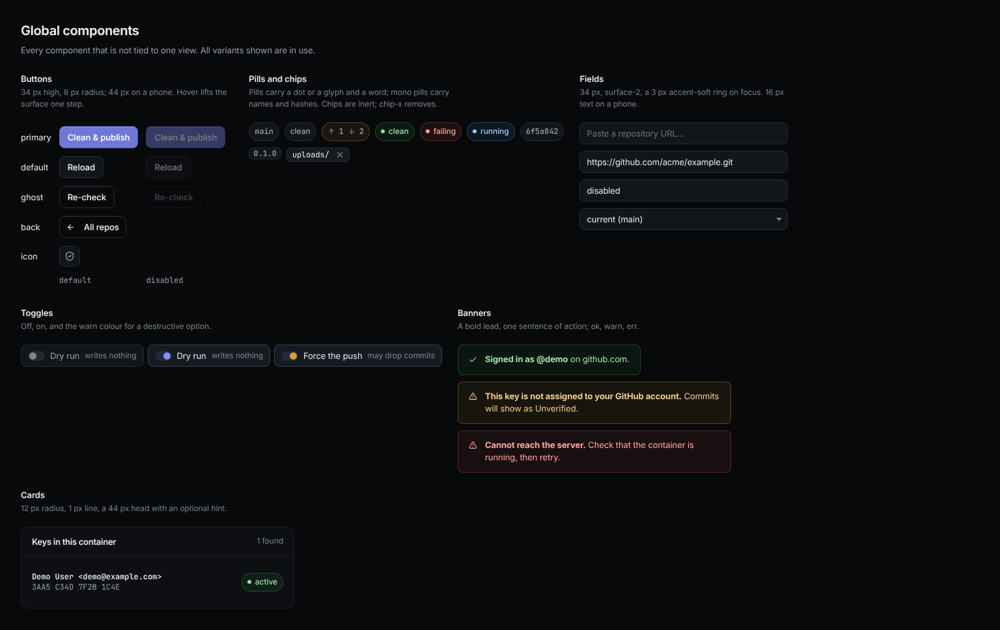
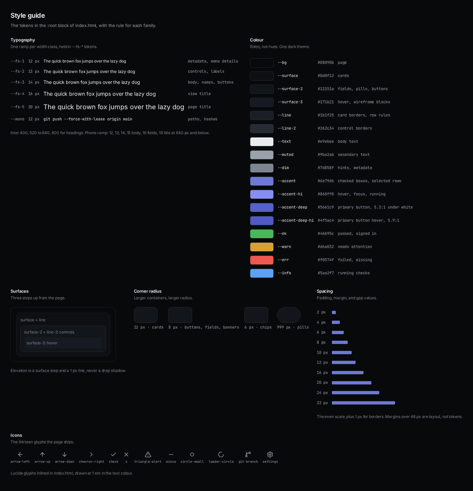
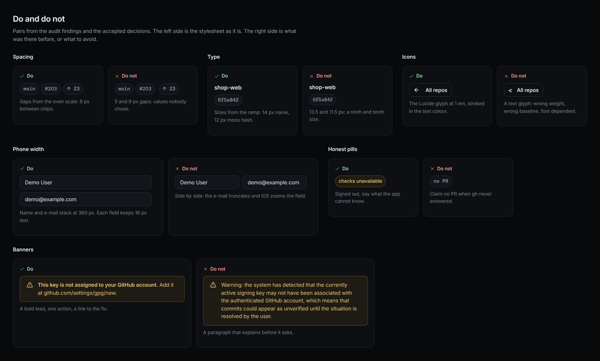

# Design record

<!-- nonemo: NMO901; nonemo: STE901; nonemo: STE902 -->

The one design record for the arena-cleanup web app. Its sections follow the nemo-ui-ux skill template. Tokens come from the `:root` block in `ui/static/index.html`.

## Purpose and status

- Goal: clean an arena branch (rewrite, sign, push) from a browser, on a phone or a desktop.
- Scope: the dashboard, repo view, and settings view.
- Constraints: one HTML file, no build step, and a dark theme only. Fonts and icons ship with the page, so nothing loads from the network.
- Acceptance checks: the pytest suite in `tests/`, screenshots at 1280 and 360 px, and the nemo-ui-ux measure reports.
- Design status: accepted for the four views. The audit findings of 2026-10-22 are fixed.

## Users, tasks, and language

- User group: one developer who owns the repos and the GitHub account. No research beyond that use.
- Primary tasks: add a repo, run a cleanup, read the log, and keep the settings right. Settings: GitHub access, signing, identity, and the claim rules.
- Repo: a clone the server registered.
  - Identifier: the server-minted `id`.
  - The card shows `name` only.
- Arena branch: a branch under the `arena/` prefix with its PR and check count.
- Run: one engine execution with five phases: Prepare, PR checks, Rewrite and sign, Push, Clean up.

## Journeys and information architecture

- Entry: the dashboard at `/`. The header holds the brand, tool dots, and one icon button (Settings).
- Dashboard to repo: a click on the card or Enter on a focused card.
  - The name underlines on hover.
  - Back: the All repos button.
- Settings opens from the header, and Back returns to the previous view. A reload keeps the screen the hash names, with no dashboard frame first.
- Delete an arena branch: the trash control on a sidebar row opens the modal, and Delete removes the branch on origin. The sidebar, the select, and the dashboard refresh after it.
- Recovery: a failed run keeps its log open, and a failed load shows a banner with the error text. The service worker caches the shell only, never server state.

## Screens and states

- Dashboard: sort select and Reload button in the head, add bar.
  - Table and cards: one table with one row per repo while it fits its room, repo cards once its natural width outgrows the room.
    - The header row reads Repo, Default, Arena Branches, and Actions. Rules of 1 px split the rows, cells pad 12 px, and a hovered row tints.
    - A row or card shows the branch.
    - The repo name is a button that opens the repo, and a click on its card body does the same.
    - The card itself has no role.
  - Empty: a hint with the add command. Error: a banner above the rows.
  - Arena rows: each has two lines at every width, the branch name, then `↑ N` and the PR pill. A name shaped `arena/<slug>-<repo>` reads as its slug, with the full name in the title.
    - `↑ N` is the net count, the commits that branch holds beyond `origin/<default>` minus the commits `origin/<default>` holds beyond it, with a tooltip.
    - The chip hides below 1, so absorbed work and a default branch that moved on show no chip.
    - No dot sits before the name or in the PR pill, its colour carries the state.
  - Remove: the trash glyph sits top right, bare at rest. A red frame comes on hover, on press, and while armed.
- Repo: a 320 px sidebar, then the run card left and the options card right, and the log card below both.
  - Cards: the run card holds the status and phase list.
    - The log card holds the open log of the latest run and takes the height that is left, down to a 160 px floor.
    - Both come back after a return to the view or a restart.
    - The main column pins to the window as the sidebar does, so only its log scrolls.
  - Run button: the one run button ends the checkbox row of the options card and drops under the boxes when the row is narrow. It reads Clean & Push while idle and Cancel while a run is live.
  - Options: each option is one row: label, control, and a trailing action or readout.
    - No hint texts.
    - Dry Run, Ignore PR Checks, Update Tags (checked by default), and No lease are checkboxes.
    - No lease is the one danger-coloured option: checked, the run pushes with `git push --force` and no lease, and its tooltip names the two other effects of `-f`.
  - PR check timeout: a slider with the number beside it, a tick per stop, and both ends named under the track. It snaps to 0, 5, 10, 15, 20, 30, 45, 60, 90, or 120 minutes.
  - Target branch: it lists the default branch first and never an `arena/*` branch.
    - A clone parked on an arena branch gets the default branch alone, sent as `-b`.
    - Arena branch appears with two or more arena branches, newest tip first.
    - Each option reads `branch · day`, and the full stamp sits in its title.
    - The chosen one goes to the run as `--arena`.
  - Sidebar: the repo facts and the arena rows on top.
    - A GitHub remote reads as the GitHub mark and `owner/repo`, a link to the repo page in a new tab. Other remotes stay plain text.
    - The commit list fills the rest and scrolls on its own.
    - Its hint is the commit count with thousands separators.
    - Reload sits in its label.
  - Commit list: 30 commits a page, and a scroll near the end appends the older page. It reads the selected arena branch on origin, and the clone HEAD when the repo has none.
    - Each row shows hash, subject, author, and date. The hash reads 7 characters, the GitHub short SHA.
    - Each arena row shows the PR state and is a button that selects the branch to pull from.
  - Flow: the page runs the full flow only.
    - `strip` is a CLI command.
    - Browse under Remove paths opens the HEAD tree of the clone, one level per request.
    - A click on a row or its plus adds the chip.
  - Runs: log rows show the clock of the browser.
    - Remove on a card arms on the first click and deletes the URL clone on the second.
    - States: idle, running, done, failed, cancelled.
  - Reset: a managed clone goes back to origin before every run. The server fetches, checks out the default branch, resets hard, and drops local `arena/*` copies.
- Settings: two columns above 1200 px.
  - Columns: left, Identity (name, email, Save), Claimed commits (two chip lists, Save), About.
    - Right, the GitHub card, then the signing cards.
    - One column at 1200 px and below, in the order Identity, GitHub, signing, Claimed commits, About.
  - GitHub card: the sign-in state, token scopes, credential helper, and ssh keys.
    - A warning and Configure appear when a signed-in user has no helper.
    - About folds, and opens on a click.
  - Actions: Save, Re-check, Sign in, Configure, Create key, and Open keys sit bottom right in the foot of their card.
  - Signing cards: gpg banner when gpg is missing, key list, create card, GitHub key steps. Disabled: Create key while gpg is missing.
  - Error: the banner names the failed check. Each card loads on its own.
- Offline: the service worker serves the shell. Data requests fail with their normal error banner.
- Loading and permission states: not run as separate checks.

## Design system and tokens

### Colour

- Roles: `bg`, `surface`, `surface-2`, `surface-3`, `line`, `line-2`, `text`, `muted`, `dim`, `accent`, `accent-hi`, `accent-deep`, `accent-deep-hi`, `accent-soft`, `ok`, `warn`, `err`, `info`.
- Tints and edges, also in `:root`: `on-accent`, `accent-edge`, `selection`, `line-hover`, `line-3`, `line-check-hover`, `card-hover`, `card-hover-line`, `thumb`, `thumb-hover`, `glass`, `glass-2`, `scrim`, `kbd-text`, `kbd-line`, `log-text`, `log-dim`, and `on-danger`.
  - Each tone has `-text`, `-line`, and `-tint`, and `err-line-hi` edges the armed button.
  - No rule below `:root` names a colour.
- One dark theme, `color-scheme: dark`.
  - Contrast checks: white on the primary button 5.3:1 at rest and 5.9:1 on hover, and `dim` text 5.1:1 on a card.
  - `accent` itself gives 3.9:1 under white, so it fills checked boxes and marks rows, never a text button.

### Type

- Inter (variable) for text, Monaspace Neon (variable) for paths, hashes, commands, and the log. Both ship as Latin subset woff2 files under `ui/static/fonts/`.
- The head preloads both files at its top and paints them with `font-display: block`.
  - A reload never flashes a fallback face.
  - Each pairs with a metric-matched local fallback face, Arial for Inter and Courier New for Monaspace Neon.
  - Line boxes hold if a file fails to load.
- Desktop ramp: `--fs-1` 12 px for metadata and mono details, `--fs-2` 13 px for controls and labels. `--fs-3` 14 px for body, names, and buttons, `--fs-4` 16 px for a view title, `--fs-5` 20 px for the page title.
- Phone ramp at 640 px and below: body 12 to 15 px, fields 16 px, and title 20 px. The 16 px fields keep iOS from zooming.
- Weights: 400, 520 to 640 for labels and names, 600 for headings and bold runs.

### Icons

- Lucide 1.61.0, vendored one glyph at a time into the `ICONS` map in `index.html`. Each glyph keeps its 24 px grid and its 2 px stroke in the text color.
- Three size tokens set the glyph box per place at every width.
  - `--ico-s` is 14 px for inline glyphs: the commit check, the stand-in for a missing author picture, the chip X, and the pill arrow.
  - Buttons, phase rows, tree rows, and banners take `--ico-m`, 16 px.
    - Icon buttons, the card mark, and the brand mark take `--ico-l`, 18 px.
    - A glyph in running text stays at 1 em.
- Navigation and file glyphs in use: arrow-left, settings, arrow-up, arrow-down, chevron-right, folder, folder-tree, file, and plus.
- State and action glyphs in use: check, x, triangle-alert, minus, circle-small, git-branch, refresh-cw, copy, user, and broom-sparkles.
- Buttons with a glyph: Reload is `refresh-cw` alone, named `Reload commits` in `aria-label` and `title`.
  - Copy log is `copy` alone, named `Copy log` the same way.
  - Re-check and Retry lead with `refresh-cw`, Copy public key with `copy`, and Browse with `folder-tree`.
  - A button that leads to GitHub leads with the GitHub mark and drops the word: Open PR, Open, Connect, and Open keys. Its `title` keeps the full phrase.
  - Every other button keeps its word alone.
- Clean buttons: every `Clean & Push` button carries `broom-sparkles`, the broom alone when idle, and the sparkles appear on hover and focus.
  - Every button leads with the glyph at `--ico-m` before its words, the dashboard rows and cards included.
  - The `Cancel` state is the word alone.
- Static slots carry `data-icon="<name>"`, and boot fills them. The brand mark is `broom-sparkles` in the accent, the app icon's glyph.
- App icon: `scripts/app_icon.py` draws `ui/static/icons/*.png` from the `broom-sparkles` paths.
  - The favicon and the regular PWA pictures carry the accent glyph alone on a transparent ground.
  - Maskable picture and Apple touch icon add the `--surface` background, full bleed, with the glyph inside the safe zone.
- No text glyphs stand in for icons. The licence sits beside the page in `ui/static/LICENSE-lucide.txt`.
- One Octicon, `github`, draws the remote link mark filled on its 16 px grid. Its MIT notice is `ui/static/LICENSE-octicons.txt`.

### Layout

- Spacing scale: 2, 4, 6, 8, 10, 12, 16, 20, 24, and 32 px, with 1 px for borders.
- Page padding `--pad`: 20 px, 16 px at 1200 px and below.
- Breakpoints, the nuu trio in em, one change each: 75em, 56.25em, and 40em.
  - Pixels: 1200, 900, and 640 px at the 16 px browser default, and the em unit moves each switch with the reader's font size.
  - 1200 px stacks the options card over the run card. It puts the settings in one column and tightens the padding.
  - 900 px stacks the sidebar below the cards, and the page scrolls as one. Folded repo cards keep as many 330 px columns as fit.
  - 640 px switches to the phone ramp, 44 px targets, and stacked rows.
    - The options sit in one column at every width.
    - No other width carries a rule.
- Radius: 12 px for cards, 8 px for buttons and fields, and 1000 px for pills. The tree select takes 6 px, the checkbox 4 px.

### Theme and motion

- Transitions of 120 to 180 ms on transform, opacity, border, and background. `prefers-reduced-motion` stops them.
- Enter motion on GSAP 3.15.0, vendored as `ui/static/gsap.min.js`.
  - The cards of the grid, the commits of a repo, and a dialog fade in and rise 8 px.
  - A view only fades, as a transform would unpin the fixed tab bar inside it.
  - The tween takes 180 ms on `power2.out`, and a list spreads its rows over 120 ms more.
  - `prefers-reduced-motion: reduce` skips the tweens.
- Scrollbars, the nuu recipe: a 10 px bar with an 8 px radius thumb in `--thumb`, the `--bg` track, and no arrow buttons.
  - `scrollbar-width` and `scrollbar-color` apply only where `::-webkit-scrollbar` is unknown, so Chromium keeps the drawn thumb.
  - Each scrolling view reserves its gutter with `scrollbar-gutter: stable`. The page root reserves none, since on a desktop it never scrolls.
- Scroll-edge fade, the nuu recipe: the commit list and log carry `scroll-panel`.
  - A scrolled edge fades over 12 px, and the fade grows and shrinks over a 192 px scroll ramp. A panel that does not scroll stays unmasked.
  - The rule needs `animation-timeline: scroll(self)` and no reduced-motion preference. Other scrolling regions keep their edges.

## Components and contracts

- `btn`: 34 px high, 12 px side padding, 8 px radius, and 44 px high on a phone.
  - Variants: `primary`, `ghost`, and `icon-btn`.
  - All of them are flat: a fill and a 1 px border, no highlight, and no shadow.
  - The close x in a dialog head rests bare, no fill and no border, and shows the surface under a pointer and while pressed.
- `pill`: dot and word, 8 px gap, 1000 px radius, `ok`, `warn`, `mono` variants.
- `commit`: grid `auto minmax(0, 1fr)`, the subject clamped to two lines with an ellipsis, the metadata on a second row.
  - The row is a button with `aria-expanded`, and a tap shows the whole subject.
  - The metadata carries the author's GitHub picture, 20 px and round, or a `user` glyph in the same disc when the server has none.
- `row-btn.select`: a sidebar arena row, a button with `aria-pressed`, two lines: the dot and the branch slug, then the tail under it. The amber dot of a running PR pulses.
  - A selected row carries text colour. Its tint and 2 px accent bar sit on its `arena-item`.
  - The name reads `Pull from <branch>`.
  - Rows and the timeout slider are 44 px high on a phone.
- `arena-item`: the arena row with its `arena-checks` and `arena-del` icon buttons side by side. Its hover tint and its selected tint span the whole row, icon buttons included, and the icon buttons keep their own hover rings on top.
  - The trash glyph is dim until hover, then reads in the error tint.
  - The name reads `Delete <branch>`.
- `modal`: a `dialog` of 420 px at most, with a title, one paragraph, and Cancel then Delete at the right. The page under any open dialog cannot scroll.
  - The backdrop dims the page.
  - Escape and Cancel close it without a request.
- `checks-modal`: a 640 px `dialog` for the checks of a PR, whose body scrolls past 60 vh.
  - One row per check, 36 px tall, with a glyph in the state colour, the `Workflow / Job` name, and a dim state phrase. A running check shows an amber pulsing dot in the glyph slot.
  - The phrase names the state and the run time, as GitHub lists them: `Successful in 41 s`, `Failed in 1 min 2 s`, `In progress`, `Queued`, `Skipped`. GitHub's rollup carries no event, so none shows.
  - A row that names an Actions job is a toggle with a chevron, and opens its `job-pane` under itself. Any other run keeps Open run.
  - Open PR, with the GitHub mark, sits alone at the right. The head x closes the dialog, as it does for `phase-modal`, whose foot shows only when it has Open.
  - Its body takes the opening focus and draws no ring, so the x never holds it. Same for `phase-modal`.
- `job-pane`: the job behind a check row, indented 24 px so its content lines up with the row name.
  - A head line with the verdict and the summed step time, then Open, with the GitHub mark, as a house 34 px button.
  - `job-steps`: one 28 px row per step with the state glyph, the name, and the seconds, or `running` behind an amber pulsing dot. Each row is a toggle with a chevron, 44 px below 40em, and opens its own log under itself.
  - `job-log`: a `pre` in the mono face, 26 vh tall at most, with one step's lines, that opens on the last 400 lines. A scroll to its top prepends the page before, and the view keeps its place.
    - Each line drops the date and the fraction of its stamp, so `11:27:19` leads it.
    - The first failed step opens on its own. A passed job opens no step, and a step without lines says so under its row.
    - A running job shows a note instead, since GitHub serves the log once the job ends.
  - Steps refresh every 10 s while a job runs. Closing the modal or the row stops the timer.
- `phase-modal`: a 640 px `dialog` behind each run phase row, which is a button once the row has lines.
  - A step list with stamp, message, and duration, the commit list after a rewrite, or the push facts as a `kv` list.
    - Prepare names three steps in place of its log: `Fetched`, `Located remote arena branch`, and `Pulled arena/<slug>`. Each takes the stamp and duration of the line that ends it, and the open step reads `Fetching…`.
  - The body scrolls past 60 vh.
- `opt.row`: a grid of three columns, `128px minmax(0, 1fr) auto`, for the label, the control, and the trailing Browse or slider readout.
  - `check`: a label with a drawn checkbox.
    - The box is 16 px, 20 px on a phone, with a 4 px radius and the surface-2 fill.
    - Checked, it takes the accent fill and a white Lucide check.
    - `danger` fills a checked destructive option with the warn colour and a dark check.
  - Phone: the checkboxes form a grid with 160 px columns. Browse, the fold head, and the 16 px path field are 44 px targets there.
- `phase`: a row with the state glyph, a name, a count, and the time. The running row holds the amber pulsing dot in its glyph slot.
  - Counts: the count comes from the engine's lines.
    - PR checks reads `passed/total`.
    - Rewrite and sign reads `collecting N commits`, then `signing X/Y`, then `signed X commits`.
  - Push reads `moving`, `pushing`, then `pushed X tags`, and stays empty without a tag.
    - A dry run reads `would sign` and `would move`.
    - Before a count the row carries the name alone.
- `repo-card`: a `tr` of `grid`, a real `table` with `th` header cells, so the columns align across rows under the header row. Once the table outgrows its room the cells hand their content to the row, which lays the card out by area.
  - Row, left to right, four cells: the icon and name, the default branch pill, the arena rows stacked, and the actions.
    - After the name, a dim `repo-since` stamp names how long ago the repo was last active, in nuu relative form: `3h ago`.
    - Last active is the newest of a check completion, an arena tip commit, and a PR edit. The title gives the full form and the source.
    - The actions cell holds Clean, and Remove with the trash glyph.
    - The arena area takes the free width, so Clean and Remove sit at the right edge.
    - In a row an arena row is one line: the name, the ahead chip, and the PR pill.
    - A clean in flight turns Clean & Push into Running: disabled, an amber pulsing dot, the same box, and the reason as its title. The row carries `aria-busy`.
    - A run started on this page marks its row Running the moment the job starts, so Back from the repo view finds it grey. The list confirms the run on its next read, and a read from before the start cannot undo the mark.
  - Card: a wrapping flex card once the table, laid out at its natural width, no longer fits its room. The page measures after each render, on each resize, and once more when the fonts are ready.
    - The icon, the name, and Remove sit on top on one centre line, then a rule. The arena rows share the next line with Clean & Push at the right edge.
    - Clean & Push breaks under the arena rows when the line is too short for both.
    - A card stretched to the height of its neighbour packs its lines at the top.
    - The cards flow in as many 330 px columns as fit: two share a row from 672 px of room, one below it.
    - The branch chip stays in the rows, and an unavailable card shows its reason in the arena area.
  - Pending: a pending card, the clone still running, dims behind a `cloning` pill and leads the grid.
- `sign-row`: label column of 120 px and a value column. On a phone the label takes a full row.
- `sign-fields`: name and e-mail side by side, one column on a phone.
- `card.fold`: a `details` card.
  - The `summary` is the card head with a `show` or `hide` mark at the right, and its body opens below.
  - Closed, the head has no bottom border.
- `banner`: `err`, `warn`, `ok` variants with an icon and one sentence of action.
- `load-bar`: a 2 px accent bar on the bottom edge of the top bar, the nuu loading recipe. It shows 200 ms into the first list read, on the dashboard alone.
  - It grows from the left on a transform and slows towards the right edge, at 85% opacity, until the list lands. Reduced motion holds a still full bar at 45%.
  - The dashboard view carries `aria-busy` while its read runs. Our bar is decorative and carries no role, since our loading line announces that read.
  - A fetch of the repo states spins the Reload glyph instead.
  - The repo view and Settings never show it, the minute fetch included.
- `run button`: one button with `data-state` idle, starting, or running.
  - Idle reads Clean & Push and is the primary.
  - Starting is disabled until the job id arrives.
  - Running reads Cancel as a plain button.
  - Idle greys with a tooltip in three cases: `reading the branch state` from the run end until the status answers, `a clean would overwrite commits on main` below 0, and `nothing to clean on <branch>` at 0. Any other idle state keeps it live, an unknown count included.
- `card-foot`: the action row of a card, right-aligned with an 8 px gap and 16 px of padding. The options card has none: its run button sits in the checkbox row.
  - Every card action sits there, so the x alone stays top right.
  - The options foot hides on a phone, where the tab bar runs.
- `tree`: the path selector.
  - Rows are `treeitem`s with `aria-level`. A folder row carries `aria-expanded` and loads its children on the first open.
  - The trailing `tree-select` button toggles the path and reports `aria-pressed`. Rows and select buttons grow to 44 px on a phone.

## Accessibility and inclusion

- Target: WCAG 2.2 AA for keyboard use and names.
  - Applied so far: a skip link, `aria-label` on icon buttons, `role="status"` for the run state, and focus rings.
  - Focus rings follow the keyboard. Tab or an arrow key sets `data-keyboard-nav` on the root, a pointer press clears it, and `:focus-visible` draws its ring under the flag alone.
  - Targets are 44 px on a phone and at least 24 px under a pointer.
- Test methods: the browser walk in `scripts/walk.py` (keyboard and names) and the measure reports (target sizes).
- Not run: screen reader sessions, contrast measurement.

## Content and assets

- Copy follows ASD-STE100: short sentences, one action per banner, no jargon beyond git and GitHub terms.
- Locale: English only. Dates use the browser locale.
- Fonts: Inter and Monaspace Neon, SIL Open Font License 1.1, see `ui/static/fonts/LICENSE.txt`.
  - Icons: Lucide, ISC, see `ui/static/LICENSE-lucide.txt`. The GitHub mark: Octicons, MIT, see `ui/static/LICENSE-octicons.txt`.
  - Motion: GSAP 3.15.0, the standard no-charge licence, see `ui/static/LICENSE-gsap.txt`.

## Behavior and data

- The repo registry and settings live on the server under `ARENA_DATA`. The page keeps no state beyond its open view.
- Pictures: the server keeps the GitHub picture of each author under `ARENA_DATA/avatars/`, one lookup per address.
  - A noreply address names the user, any other costs one `gh api` call.
  - A picture lives 30 days after its last use, a use renews it, and expired ones get pruned.
  - The page loads them from the server, never from GitHub.
- Commits: the commits API answers 30 a page with a `next` cursor, the sha of the last commit of a full page.
  - `before=<sha>` answers the page after it.
  - Reload starts at the first page again.
- Status: the dashboard reads every repo's status every 20 s, and the open repo view takes its entry from that read.
  - Sidebar, branch selects, and button repaint only on a changed status.
  - A live run, and its end until the branch state answers, keep the view as it is.
  - The commits list follows the selected arena branch and its tip through every status change.
- Latest run: the server keeps the newest run of each repo in memory and writes the finished one to `ARENA_DATA/jobs/`.
  - The repo view asks for it on open.
    - A live run streams on from its first line.
    - A dropped stream polls for the lines the view lacks, never for the whole log again.
    - A run's answers stay with the run and its repo. A view that moved on paints none of them.
    - A finished run paints at once with its log, phases, and status.
  - A removed repo takes its saved run with it.
- Defaults: PR check timeout 15 minutes, dry run off.
- Validation: the add bar accepts a clone URL, a GitHub page address, or an absolute path.
  - Another shape gets an error line under the field, with `aria-invalid` and `aria-describedby` on the field until the next keystroke.
  - A clone or a path the server refused reports under the field too. Every other error goes to the toast, which holds an error 5 s and a receipt 2.2 s.
- Retries: none automatic. Re-check and Reload buttons repeat a read.
- Fetch: the server runs `git fetch --prune origin` in every repo at the top of each clock minute.
  - The timer aligns to the wall clock, so it never drifts.
  - A page load fetches once, and the dashboard Reload button fetches now.
  - The Reload glyph spins while any fetch is in flight, and stops with the last one.
  - A repo with a run in flight waits for the next tick.
- One fetch at a time: a fetch that arrives while one runs waits for it and skips its own.
  - The server skips a fetch within ten seconds of the last one, except from the Reload button.
  - A fetch swaps fresh statuses into the cache, it never empties it.
  - The dashboard shows `Loading repos…` until the first answer.

## Evidence and handoff

- 2026-10-22 audit, before the fixes: nine font sizes at 1280 px and six at 360 px.
  - The signing fields, commit rows, and access rows broke at 360 px.
  - Create key stayed enabled without gpg, and icons were text glyphs.
- 2026-10-22 after the fixes: screenshots of the four views at 1280 and 360 px, plus measure reports.
  - They show five sizes at 1280 px, stacked rows at 360 px, and inline SVG icons.
  - The 8 px scale check still reports the 6, 10, and 12 px steps.
  - See the decision below.
- Readiness: implemented. The spacing audit runs in `tests/e2e/`, the walk from `scripts/walk.py`.
- Boards: `docs/boards.json` names the seven boards below. Six are HTML fragments in `docs/boards/`, styled by the live stylesheet, and one frames the demo views.
  - Shoot the views: `uv run scripts/walk.py --views --out docs/walk/views`. Its `dashboard` view doubles as `docs/ui-overview.png` in README: copy it over.
  - Render: `nuu board -T design -s docs/boards.json -o docs/design` after a token, glyph, or component change. Edit the fragment when a token or glyph joins `index.html`.

### Boards

## Decisions and history

- Accepted 2026-10-22: one type ramp per width class, held in `--fs-*` tokens, instead of the nine ad hoc sizes.
- Accepted 2026-10-22: inline SVG icons, no icon font, and no text glyphs. Later that day the hand-drawn paths gave way to Lucide glyphs, as the house clause asks.
- Accepted 2026-10-22: the even spacing scale with 1 px borders stays. The 8 px house scale stays out, because the dense rows need 6 and 10 px steps.
- Accepted 2026-10-22: two breakpoints at 980 and 720 px.
  - 1180 px is the content width, not a breakpoint.
  - Four option columns went, because the divergence control overflowed between 981 and 1179 px.
- Accepted 2026-10-22: in a narrow cell a segmented control wraps whole buttons onto a second row, never words.
- Accepted 2026-10-22: a shallow history.
  - The dashboard is the root entry and a sub-view is at most one entry deep.
  - One Back leaves a sub-view, the next one leaves the page.
- Accepted 2026-10-22: no command switch on the repo page. A local rewrite without a push is a terminal task, so `strip` lives in the CLI alone.
- Accepted 2026-10-22: the whole options card folds, not the Target branch row alone.
  - The select names the default branch first, keeps its empty value, and lists no `arena/*` branch.
  - The server refuses one too.
- Accepted 2026-10-22: with two or more arena branches the page selects one, newest tip first, in the options card.
  - The engine gained `--arena NAME` for it and keeps the full flow.
  - The page never passes `-b arena/*`.
- Accepted 2026-10-22: the sidebar grows to 320 px.
  - The commit list sits below the repo facts and arena rows.
    - The HEAD block goes.
    - The hash leads each commit row.
  - Below 900 px the sidebar stacks under the run card instead of hiding. The commit list then grows with the page: one scroll per screen.
- Accepted 2026-10-22: a click on a sidebar arena row selects the arena branch the run pulls from.
  - The Arena branch select and the row follow each other.
  - The marked row never sets the target branch.
  - With one arena branch the row only shows which branch that is.
- Accepted 2026-10-22: the options card loses its hint texts and the task note above it.
  - Each option is one row.
    - The switches become checkboxes with Title Case labels.
    - Update Tags is the positive form of `--no-tags`.
  - Keep arena branch goes.
    - The reset before every run drops local copies, so a kept branch never reaches the next run.
    - The timeout is a slider with ten stops and a readout.
- Accepted 2026-10-22: a managed clone holds nothing of its own.
  - The server resets it to origin before every run and drops local `arena/*` copies.
  - The page loses the Reset button, dirty chip, and On divergence.
  - `--on-divergence` stays a CLI flag.
- Accepted 2026-10-22: the card and the sidebar show how far each arena branch is ahead of the default branch.
  - The clone's own drift stays out of sight.
  - Nobody commits in the container, and the engine handles that divergence itself.
- Accepted 2026-10-22: the primary button reads Clean & Push. The phase list keeps Publish for the push, tags, and cleanup step.
- Accepted 2026-10-22: a tree selector for Remove paths.
  - It reads `git ls-tree` of HEAD in the clone, so it works for path repos and never calls GitHub.
  - File contents stay out.
  - A path only old commits carried stays a typed chip.
- Accepted 2026-10-23: the breakpoints move to the nuu widths 1200, 900, and 640 px.
  - 1200 folds the options, 900 stacks the page, 640 is phone width.
  - Between 981 and 1200 px the options lose their two columns, and nothing clips.
- Accepted 2026-10-23: an audit against this record found eight lines that did not hold.
  - The page moved to the record.
  - Pointer targets are at least 24 px.
  - Every banner leads with its glyph, and the type weights stay in the set.
- Accepted 2026-10-23: the primary button takes `accent-deep`, 5.3:1 under white, and `accent-deep-hi` on hover. The `accent` token stays for fills and marks.
- Accepted 2026-10-23: the options card puts the selects and Remove paths left, PR check timeout and the checkboxes right. One grid with column-locked rows: PR check timeout shares the Target branch row, the checks share the next row.
- Accepted 2026-10-23: the page draws its checkboxes. `appearance: none` drops the browser box, so the boxes match the select and fields in every browser.
- Accepted 2026-10-22: the card Remove X moves from the action row to the top right corner.
  - At rest it is a bare glyph, so the primary button stands alone.
  - The red frame returns on hover, on press, and while armed.
- Accepted 2026-10-23: a commit subject wraps to two lines, then an ellipsis. The row is a button, and a tap shows the whole subject on a phone without hover.
- Accepted 2026-10-23: the latest run's log stays open under the phase list.
  - Show log goes, and Copy log is a glyph button.
  - An empty log reads `No run yet.`
- Accepted 2026-10-23: three icon size tokens at every width, 14, 16, and 18 px.
  - The glyphs no longer follow the text size.
  - That rule left most of them at 12 or 13 px on a desktop.
- Accepted 2026-10-23: the arena row on a card is two lines at every width, name first. The dots before the name and in the PR pill are gone, the pill colour is the signal.
- Accepted 2026-10-23: the ahead chip shows the net count and hides below 1. Absorbed commits read 0, and a default branch that moved on reads below 0.
- Accepted 2026-10-23: the repo name is the control that opens the repo. The card lost its button role, so Remove and Clean & Push no longer sit inside a control.
- Accepted 2026-10-23: Monaspace Neon replaces JetBrains Mono for monospace, Inter stays for prose. Both load by the offline fonts recipe: one subset variable file each, preloaded, `font-display: block`, and a metric-matched local fallback face.
- Accepted 2026-10-23: the ahead counts read origin as it is now.
  - The server fetches at the top of each clock minute.
  - A page load fetches once, and a dashboard Reload button fetches on demand.
- Accepted 2026-10-23: the repo view reattaches to the latest run. The server saves each finished run per repo, so the log survives a return to the view and a restart.
- Accepted 2026-10-23: one fetch of every origin at a time, with a ten second debounce that the Reload button skips. Fresh statuses swap into the cache after the fetch, and the dashboard reads `Loading repos…` until the first answer.
- Accepted 2026-10-23: the PR pill counts checks by the engine rule, one entry per check name, a pass over a superseded attempt. The rule lives in the engine, and the server calls it.
- Accepted 2026-10-23: the run card sits left and the options card right, the log card below both at full width.
  - The main column pins to the window, and the log fills what remains above a 160 px floor, so the page itself never scrolls.
  - 1200 px stacks the two cards, options first.
- Accepted 2026-10-23: Clean & Push and Cancel are one button with two states, in the options card head. The options card no longer folds, and its chevron is gone.
- Accepted 2026-10-23: the primary button is flat. Its inset top highlight and drop shadow read as a bevel, so both are gone.
- Accepted 2026-10-23: the log clock takes `dim`, 5.1:1 on the card. Its own grey read at 2.55:1, under the 4.5:1 floor.
- Accepted 2026-10-23: the run card and the options card stretch to one height. The options body has no vertical padding and no rule under its last row, so its rows sit like the phase rows.
- Accepted 2026-10-23: the phase rows lose their hint texts. A row shows a count once the engine reports one: checks and how many still run, commits signed of the total, and tags moved.
- Accepted 2026-10-23: the counts read `passed/total` for the checks, `collecting`, `signing X/Y`, and `signed X commits` for the rewrite, and `moving`, `pushing`, and `pushed X tags` for the push. The Publish row carries the name Push, and a run without tags leaves it empty.
- Accepted 2026-10-23: the commit rows show the author's GitHub picture for every author. The server caches one picture per address for 30 days after its last use and prunes the rest.
- Accepted 2026-10-23: app icon and brand mark are the Lucide `broom-sparkles` glyph in the accent. Regular pictures are the glyph alone, the maskable picture and Apple touch icon get the dark ground.
- Accepted 2026-10-23: the scroll-edge fade applies to the commit list and log alone.
- Accepted 2026-10-23: human-facing text says push, not publish, and PR, not pull request. Identifiers, API fields, and the history above keep their words.
- Accepted 2026-10-23: above 1200 px the dashboard shows one full-width row per repo on shared columns.
  - The arena area takes the free width, and Clean and Remove sit at the right edge. An arena row is one line there, and two branches stack.
  - At 1200 px and below the repos stay cards with two-line arena rows. Remove carries the trash glyph at every width.
  - The spread beats the nuu ink ratio: the arena area of a one-branch row reads 0.21 to 0.24, under the 0.25 line.
- Accepted 2026-10-23: the dashboard sorts the repos by the newest arena tip, by name, or by PR state with failures first. The select sits beside Reload and the browser keeps the choice.
- Accepted 2026-10-23: the dashboard Clean & Push button reads the glyph and the words again in rows and cards. A card puts it bottom right and drops the branch chip.
- Accepted 2026-10-23: the commit hint is the count alone, with thousands separators. The list pages 30 at a time, a scroll near the end loads the older page, and Reload restarts.
- Accepted 2026-10-23: each sidebar arena row carries a trash control.
  - A modal names the branch and asks first, with no warning about an open PR.
  - Delete drops the branch on origin and refreshes the views.
- Accepted 2026-10-23: the settings page is two columns above 1200 px.
  - The help cards How git reaches GitHub and About fold at every width.
  - The page drops from 2037 px to 1089 px at 1280, and from 2728 px to 2219 px at 360.
- Accepted 2026-10-24: the three media queries read 75em, 56.25em, and 40em, after the nuu sheet moved its breakpoints to em. Same widths at the 16 px default, earlier switches for a larger browser font.
- Accepted 2026-10-24: four values move to the 4 px scale after the nuu audit.
  - Fields pad 12 px instead of 10, and the pill gap is 8 px instead of 6.
  - The phone keeps the 16 px page padding instead of 14, and its title reads the 20 px ramp size instead of 19.
  - The pill radius reads 1000 px, the same shape on this scale.
- Accepted 2026-10-24: the PR pill and the sidebar dot paint running checks amber, the GitHub pending colour, instead of blue.
- Accepted 2026-10-24: the run timeline's running glyph is amber too, so every spinner in the app shares the `warn` role. The status led keeps the accent pulse.
  - A PR without checks gets a grey dot.
  - The `info` token keeps the debug log rows.
- Accepted 2026-10-24: a sidebar arena row takes two lines, as the cards do.
  - Dot and name first, then the ahead count and PR meta under the name.
  - The tail used to wrap right aligned only when it did not fit.
- Accepted 2026-10-24: list edits show before the reply, nuu rule 10.
  - The arena row leaves on Delete, the card leaves on Remove, and Add puts a dimmed pending card first.
  - A refused call puts the row back with the error, a lost connection sends the write once more.
- Accepted 2026-10-24: no surface casts a drop shadow, nuu clause 6.
  - The toast and the jump button lost theirs, so the primary button, cards, and floats are all flat.
  - The 3 px focus rings stay.
- Accepted 2026-10-24: every transition takes `--fast`, 160 ms, on `--ease`, one curve, nuu clause 8. The spinners and the LED pulse are CSS animations and keep their own timing, and reduced motion stops them all.
- Accepted 2026-10-24: the delete modal carries an `x` icon button top right, nuu clause 15. It submits `cancel` like the Cancel button, which keeps the first focus.
- Accepted 2026-10-24: every `:hover` rule sits in its own `@media (hover: hover)` block in place, nuu clause 9. The cascade order stays, and `:focus-visible` and `:active` apply on every device.
- Accepted 2026-10-24: the 36 colour literals below `:root` moved onto 29 role tokens, nuu clause 3. The pills and the banners share one text, line, and tint per tone, a shift of at most two per cent in alpha.
- Accepted 2026-10-24: the How git reaches GitHub fold goes.
  - Its one control, Configure, already sat in the GitHub card.
  - That card takes the helper and ssh rows and their warning, and the README takes the SSH mount hint.
- Accepted 2026-10-24: every card action sits bottom right in a `card-foot`, nuu clause 15.
  - The run button leaves the options card head, and the Save, Re-check, Sign in, Configure, and key buttons leave their bodies.
  - Create key takes its natural width.
- Accepted 2026-10-24: the hash picks the first frame.
  - The boot sequence hides the views the hash does not name before it loads environment and repos.
  - A reload off the dashboard shows no dashboard interstitial.
- Accepted 2026-10-24: Clean & Push rests when no arena branch is ahead on origin.
  - The dashboard button, run button, and phone bar grey out and name the reason.
  - A named target branch is cleaned in place, so it keeps the run button live, and the status refresh wakes the buttons.
- Accepted 2026-10-24: the repo fetch shows a loading bar under the header.
  - The server counts two steps per repo and serves the count.
  - The page polls it while its fetch request is open, and once a minute it looks for the clock fetch.
- Accepted 2026-10-24: the ahead chip compensates the arrow glyph.
  - The icon box keeps 3 px of blank on each side.
  - The icon moves 2 px in and the gap drops from 8 to 6 px, both on the even scale.
  - The ink sits within 1 px of the count's own inset on each side.
- Accepted 2026-10-24: a PR checks pill with checks is a button and opens the checks modal.
  - A PR without checks keeps its link pill.
  - The server lists each resolved check with its state and the first run URL of that name.
  - The status refresh repaints the open modal, so a running check settles in place.
- Accepted 2026-10-24: a check row opens its Actions job in place, steps first, the paged log below, and the modal scrolls inside.
  - The server reads the job and its log through `gh api`. It caches the log for 30 s and serves 400 lines per page, last page first.
  - The log loads older pages on a scroll to the top. The steps refresh every 10 s while the job runs.
  - A check from an app keeps Open run, since only Actions has a job to show.
- Accepted 2026-10-24: the page cannot scroll under an open dialog. The root hides its overflow while a `dialog` is open, and the modal body contains its overscroll.
- Accepted 2026-10-24: the phase rows read the log as a forward-only timeline.
  - A line names the current phase or a later one.
  - Each phase starts where the last one ends, so the rows add up to the wall clock.
  - A phase test matches the start of an engine line, never a word inside a branch or repo name.
- Accepted 2026-10-24: a reload of the repo list reads the pending cards after its wait. A clone refused during the reload has left the list by then, so the reload does not bring its card back.
- Accepted 2026-10-24: the phase modals read the run from its log.
  - Prepare, PR checks, and Clean up list their stamped lines, each with the time to the next line.
  - Rewrite and sign fetches the commits after the rewrite.
  - Push reads the old hash from the pull line, the new one from the pushed line, and tags from moved lines.
  - Finish reads Clean up, as the row names the wrap-up steps.
- Accepted 2026-10-24: the motion set runs on a vendored GSAP, nuu clause 8.
  - One helper fades an entering view, card, commit, or dialog in over 180 ms on one curve.
  - All but the view also rise 8 px.
  - A reduced-motion preference turns it off.
  - The service worker caches the script with its shell.
- Accepted 2026-10-24: the nuu audit's off-scale values move to the 4 px scale, as the four values before them did.
  - The icon buttons and the path input pad 0, so no browser default stays.
  - Back pads 12 px, and the brand link 8 px.
  - The phase rows and Browse gap 8 px, the step and log rows 12 px.
- Accepted 2026-10-24: a phone hit area grows without a visual change.
  - The PR pill and the repo name carry an unseen box 10 px above and below, so a thumb hits 44 px.
  - The claim inputs are 44 px tall on a phone.
- Accepted 2026-10-24: a list enters as one spread.
  - Every row of a loaded page animates, and the stagger is a 120 ms amount, not 30 ms per row.
  - A fixed per-row delay left the rows after the twelfth solid while earlier rows were still transparent.
- Accepted 2026-10-24: below 40em a step row is two lines: the stamp with the duration, then the text at full width.
- Accepted 2026-10-24: the claim inputs carry the built-in fallback as their placeholder while empty, so the card needs no sentence for it.
- Accepted 2026-10-24: the loading bar belongs to the dashboard. Other views hide it, the minute fetch included.
- Accepted 2026-10-24: the loading bar marks the first list load alone, a 30% fill that sweeps it until the list lands. A fetch of the repo states spins the Reload glyph with no bar, and reduced motion holds the fill still.
- Accepted 2026-10-24: a dashboard row shows a clean in flight with a pill and a greyed button that names the reason. The server flags the repo on every list read.
- Accepted 2026-10-24: the remote fact links a GitHub remote as the GitHub mark and `owner/repo` in a new tab. The mark is the one filled glyph, from Octicons.
- Accepted 2026-10-24: the Prepare modal names three steps instead of its log lines. Later steps show only once the phase reaches them.
- Accepted 2026-10-24: Clean & Push greys only when a clean would overwrite commits on the default branch, read from the net count. An absorbed branch keeps the button live, and the run reports nothing to push.
- Accepted 2026-10-24: Clean & Push greys from the run end until the status answers, and stays grey while the picked branch has nothing ahead. Commits ahead re-arm it, and this replaces the overwrite-only rule above.
- Accepted 2026-10-24: dates read in 24-hour time. The shared formatter sets `hourCycle` to `h23`, so a commit date reads `Oct 24, 18:11`, and the log stamps keep their `HH:MM:SS`.
- Accepted 2026-10-24: the hover tint and the selected mark of a sidebar arena row span the whole row, icon buttons included. The icon buttons keep their own hover rings on top of the row tint.
- Accepted 2026-10-24: Clean & Push ends the checkbox row of the options card, and drops under the boxes, right-aligned, when the row is narrow. The button keeps the 34 px control height, and the phone keeps its tab bar.
- Accepted 2026-10-24: every commit hash reads 7 characters, the GitHub short SHA, in the commits list, the run log, and the phase modals. Git's own abbreviation grows with the clone.
- Accepted 2026-10-24: the checks modal takes the house sizes after the nuu audit. A check row reads 44 px below 40em, and Open on GitHub is a 34 px button with 12 px sides.
  - The log pads 8 by 12 px, and the pane indents 24 px to line up with the row name.
- Accepted 2026-10-24: the Commits list follows the selected arena branch on origin, its whole history with the commits ahead on top. A click on another arena row reloads it, and a repo with no arena branch lists the clone HEAD.
- Accepted 2026-10-24: the phase rows start on the engine's own lines. A word test matched branch and repo names, so a name like arena-cleanup moved a run to Clean up and left the middle rows skipped.
- Accepted 2026-10-24: the server keeps 32 finished jobs with steps and log by job id. The page keeps 20 loaded details for a reopen.
  - A running job refreshes on every poll, and its first read after the end replaces the short log.
- Accepted 2026-10-24: the design boards render through `nuu board -T design` from `docs/boards.json`, and the project script that drew them is gone. The boards keep their markup, chrome, and sizes.
- Accepted 2026-10-24: above 1200 px the repos are one table, not row-shaped cards, and the cards below 1200 px keep their shape.
  - A header line reads Repo, Branch, Arena branches, and Actions. Rules of 1 px split the rows, cells pad 12 px, a hovered row tints, and the Sort select stays.
- Accepted 2026-10-24: the rows view is a real `table` element with `th` header cells, and the header reads Repo, Default, Arena Branches, and Actions.
- Accepted 2026-10-24: the rows fold into cards by measurement, not at a fixed width. The page lays the table out at its natural width, compares it with the room, and toggles the cards on render and on resize.
- Accepted 2026-10-24: a button that leads to GitHub shows the GitHub mark instead of the word. Its title and accessible name keep the phrase.
- Accepted 2026-10-24: the Clean & Push button carries a live run itself, as Running with an amber spinning glyph, and the `clean running` pill is gone. Both labels share one grid cell, so the button keeps its width and height across states.
- Accepted 2026-10-24: every amber dot pulses like the LED: a running check, a running job step, and the sidebar dot of a running PR. The run timeline glyph, the Running button, and Re-check keep their spinners.
- Accepted 2026-10-25: every amber state is a live state and pulses the dot. The run timeline glyph and the Running button drop their amber spinners, and Re-check keeps its neutral one, since a fetch is no amber state.
- Accepted 2026-10-25: the close x of a dialog head has no idle fill and no idle border. Its surface shows on hover and while pressed, so the head reads as a title with one quiet control.
- Accepted 2026-10-25: a check row reads like GitHub's PR checks list: `Workflow / Job`, the state glyph, and the state phrase with its duration. No GitHub mark per row, and the row still opens its steps and log.
- Accepted 2026-10-25: a card puts Clean & Push on the arena line, right-aligned, and breaks it under the rows on a short line. A button alone on its own line read as wasted ink.
- Accepted 2026-10-25: folded cards flow in two columns whenever two 330 px cards fit. The one-column rule below 900 px is gone, since a lone column wasted the width of a tablet.
- Accepted 2026-10-25: the checks and phase modals drop the foot Close, since the head x closes them. The foot keeps only Open PR or Open, and the delete confirm keeps Cancel beside Delete.
- Accepted 2026-10-25: in checks and phase modals, opening focus lands on the body. The nuu modal recipe keeps it off the x.
- Accepted 2026-10-25: a removal in flight stays out of every repo list reload. A refused one brings its row back from the server list.
- Accepted 2026-10-25: scrollbars follow the nuu recipe in full, with the hover tint kept. The page root drops its reserved gutter, which cost 10 px on every desktop view.
- Accepted 2026-10-25: the loading bar follows the nuu recipe. A 200 ms delay, growth from the left on a transform, and `aria-busy` on the dashboard view replace the 30% sweep.
- Accepted 2026-10-25: an arena branch named `arena/<slug>-<repo>` reads as its slug, since the tail repeats the repo name. The full name stays in the title, in the delete dialog, and in every command.
- Accepted 2026-10-25: the demo names arena branches `arena/<slug>-<repo>`, as real sessions do, so every board and the README image show the slug form.
- Accepted 2026-10-25: the dashboard repaints its cards only when a list read changed something. Focus, an armed Remove, and an open job log's scroll survive a tick, and the relative stamps update in place.
- Accepted 2026-10-25: an error toast stays 5 s and a receipt 2.2 s. A refused clone reports under the add field, as a bad source does.
- Accepted 2026-10-25: a dashboard card greys Clean & Push for overwrite and nothing-ahead reasons, through one guard shared with its repo view. That view alone adds `reading the branch state`.
- Accepted 2026-10-25: a repo view opens on its list entry and greys Clean & Push, `reading the branch state`, until the fresh status lands. A click never runs on a status older than that read.
- Accepted 2026-10-25: Cancel toasts `cancelling` when the server took the request, and the error when it did not. Only the status line says `cancelled`, once the run ended.
- Accepted 2026-10-25: the Running button shows its dot bare. The busy face narrows the glyph box to the dot, so dot and label centre as a pair with an 8 px gap.
- Accepted 2026-10-25: the dashboard names how long ago a repo was last active, the newest of check completion, arena tip commit, and PR edit. The compact nuu form sits after the name, the full form and the source in its title.
- Accepted 2026-10-24: page memory keeps commit pages by repo, ref, tip, and cursor, the settings and signing answers, and the last run per repo. Each paints at once, and a fresh read replaces it only when the answer differs.
- Accepted 2026-10-25: a step row in the job pane is a toggle for its own log lines, as on GitHub's job page. The first failed step opens on its last page, a passed job opens no step, and each open log pages on its own.
  - The server splits the job log on the step start times. Lines in a second that two steps share stay with the earlier step until the later step's opening line.
- Accepted 2026-10-25: the focus ring shows on keyboard travel alone, nuu clause 9. A script focus or a pointer press draws none, and the generic ring no longer rounds a control's corners on focus.
- Accepted 2026-10-25: three house density readings stay as they are, recorded as nuu deviations.
  - nuu-deviation: phase-rows-ink: the phase timeline rows ink 0.11 to 0.30 of their 441 px at 1280 px. Each row holds a dot, a name, a count, and a time.
  - nuu-deviation: settings-column-ink: the settings column inks 0.13 of 1280 px, two cards over a sparse page
  - nuu-deviation: add-bar-width: the add bar field spans its row at 1280 px, a URL or an absolute path needs the room
- Accepted 2026-10-25: the timeout slider follows the nuu range recipe. A tick marks each of its ten stops, both ends read 0 and 120 min in mono, and the readout stays beside the track.
- Accepted 2026-10-26: the live dot in every pill and button grows from 6 to 8 px, the nuu live-dot default. The header tool dots keep 6 px, the recipe's small size for a dense row.
